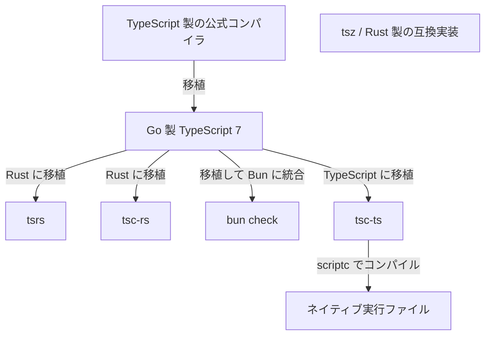
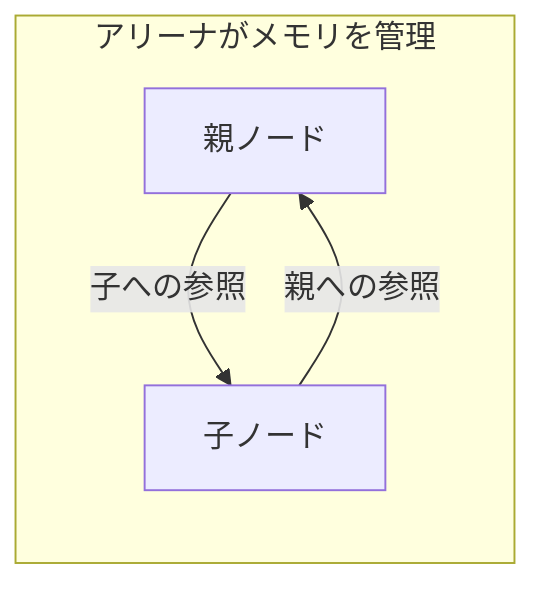

## はじめに

2026 年 7 月 8 日、Go で実装された [TypeScript 7.0](https://devblogs.microsoft.com/typescript/announcing-typescript-7-0/) が正式にリリースされました。公式発表では従来の TypeScript 6 と比べてフルビルドが概ね 8〜12 倍速くなったと報告されています。

そこから約 3 か月後の 10 月、Go 版をもとにした Rust 製の別実装の動きが目立つようになりました[^timing]。10 月 10 日には [Bun 1.4.3](https://bun.com/blog/bun-v1.4.3) が `bun check` を公開し、20 日には Cloudflare と VoidZero が [tsrs への協力体制](https://blog.cloudflare.com/typescript-rust-port/) を発表しています。

`tsc-rs` も含め、Rust に移植するプロジェクトが複数進んでいます。公式の Go 実装も引き続き開発されており、Rust 版は別プロジェクトです。

TypeScript チームは Rust も検討したうえで Go を選んでいます。それなのに、今度は Rust への移植がいくつも進んでいるのが気になったため、これまでの経緯と各実装の特徴を調べてみました。

この記事では TypeScript 5 から Go 移植までを振り返り、各実装の特徴を見ながら、Rust 製の別実装が相次いだ背景を考えてみます。公開ベンチマークや、Rust 以外の方法で高速化する処理系も紹介します。

※情報は 2026 年 10 月 27 日時点のものです。ベンチマークは開発元や測定者が公開した結果を引用しており、自分の環境で測定したものではありません。

## 型チェックとトランスパイルについて

TypeScript の型注釈の除去や構文の変換によって JavaScript を生成するのがトランスパイルです。一方、代入や関数呼び出しが型のルールに合っているかを調べるのが型チェックです。

```ts
const count: number = "3";
```

このコードは型注釈を取り除けば JavaScript として実行できますが、型チェックではエラーになります。

esbuild は TypeScript を変換できますが、型チェックは行いません。[公式ドキュメント](https://esbuild.github.io/content-types/#typescript) でも、型チェックには別途 `tsc --noEmit` を使うよう説明されています。[SWC](https://swc.rs/docs/usage/cli) や [Oxc](https://oxc.rs/docs/guide/usage/transformer) も TypeScript の変換機能を提供していますが、今回の中心は型チェック自体を高速化する処理系です。

## TypeScript 5 から Go 移植まで

TypeScript は [2012 年 10 月に公開](https://devblogs.microsoft.com/typescript/ten-years-of-typescript/) され、長く TypeScript で書かれたコンパイラを JavaScript にして動かしてきました。Go に移植する前にも、既存実装の高速化は続いています。

| 日付 | 出来事 | コンパイラの変化 |
| --- | --- | --- |
| 2025 年 3 月 11 日 | [Go への移植を発表](https://devblogs.microsoft.com/typescript/typescript-native-port/) | ネイティブコードと並列処理による高速化を目指す |
| 2025 年 5 月 22 日 | [Native Preview 公開](https://devblogs.microsoft.com/typescript/announcing-typescript-native-previews/) | npm から Go 版を試せるようになる |
| 2026 年 3 月 23 日 | [TypeScript 6.0 公開](https://devblogs.microsoft.com/typescript/announcing-typescript-6-0/) | JavaScript ベースの最後のメジャーリリースとする方針 |
| 2026 年 7 月 8 日 | [TypeScript 7.0 公開](https://devblogs.microsoft.com/typescript/announcing-typescript-7-0/) | Go 製コンパイラを正式に提供 |

[TypeScript 5.0](https://devblogs.microsoft.com/typescript/announcing-typescript-5-0/) では、内部オブジェクトの構造をそろえて JavaScript エンジンが処理しやすくするなどの改善が行われました。7.0 ではネイティブコードで動かし、複数の CPU コアも利用するようになった、という流れです。

ちなみに、`tsc` は公式コンパイラのコマンド名で、7.0 では Go 製の実行ファイルを起動します。`tsgo` はプレビュー時のコマンド名であり、Go 実装を指す名前としても使われます。この記事でも、従来の JavaScript 実装と区別するときに使っています。

## なぜ Go が選ばれたのか

### 既存の挙動を保って移植したかった

公式の [Why Go?](https://github.com/microsoft/typescript-go/discussions/411) では、言語選定の最大の条件として既存実装との互換性を挙げています。型チェックの結果に加えて、コードの構造を似せることも重視していました。

旧実装と新実装を並行して保守するには、片方の変更をもう片方に移しやすい方が便利です。Go は既存のコーディングパターンに近く、メモリ配置を制御しながら、不要なメモリを回収する GC も使えます。

TypeScript の内部では、構文を表す AST、名前と宣言を結ぶ Symbol、型情報などが相互に参照します。構文の親子関係は木構造ですが、実装には子から親へ戻る参照もあり、参照をたどると循環します。こうした参照関係を保ちやすいことが、Go を選ぶ理由になっていました。

### Rust への移植で難しかったこと

Anders Hejlsberg は [インタビュー](https://commandline.microsoft.com/typescript-7-0-anders-hejlsberg-peterman-pod/) で、Rust も試したものの、循環するデータ構造を多用する既存実装の移植には適さなかったと説明しています。

自分は GC を前提にした参照や後からの書き換えを、従来の構造を保って Rust に移す作業の難しさを説明している、と理解しました。Rust で循環参照を扱う方法は、この後の `tsrs` でも使われています。

Rust で書くなら、参照の表現やメモリを解放する単位などを別途設計できます。ただし、その分だけ移植の作業も増えます。互換性を保ちつつ少ない変更で高速化したい、という目的では Go が適していたということですね。

このあたりの歴史や構造は、TSKaigi 2026 の [制約と時代から読み解く TypeScript コンパイラ設計史](https://docswell.com/s/6114195/K8NM12-2026-05-23-103822-tskaigi) でも詳しく解説されています。

## その後の TypeScript 処理系

2026 年 10 月時点の主な処理系を、ざっくり整理してみました。

| 処理系 | 実装と由来 | 主な特徴 |
| --- | --- | --- |
| `tsc` / `tsgo` | Go 製の公式実装 | 互換性を比較する基準 |
| `tsrs` | Go 版を Rust に移植 | メモリ配置の最適化、WebAssembly 対応 |
| `tsc-rs` | Go 版を Rust に移植した別プロジェクト | AI による移植、Effect 向けの診断機能 |
| `bun check` | Go 版を移植し、Rust 製の Bun に統合 | 実行・テスト・ビルド前に型チェック |
| `tsz` | Rust 製の TypeScript 互換実装 | Checker と Solver を分ける設計 |
| `tsc-ts` | Go 版を TypeScript に移植 | `scriptc` でネイティブコードにコンパイル |

移植元を図にすると、以下のようになります。`tsz` は設計を組み直した互換実装なので、同じ方式の移植としては結んでいません。



### tsrs

2026 年 10 月 20 日、Cloudflare と VoidZero は、Owner.com の Max Schwenk 氏とともに [tsrs](https://github.com/oxc-project/tsrs) に取り組むと発表しました。Oxc のツールチェーンの一部として開発し、TypeScript チームとも協力する方針です。

[移植ガイド](https://github.com/oxc-project/tsrs/blob/main/docs/PORTING.md) によると、`tsrs` は Go 版のアルゴリズムや関数の分割、処理順序を保つ方針です。一方、メモリ管理には独自の実装を使っています。

循環参照するオブジェクトは、メモリをまとめて管理するアリーナに確保します。オブジェクト同士は `P<T>` という型で参照します。

型チェック用のスレッド内だけで使うデータの更新には、`Cell` や `RefCell` などの内部可変性を使います。複数のスレッドで共有する AST などには独自の `OwnedCell` / `FrozenCell` を使い、原則として型チェック前に更新を終えます。遅延初期化が必要な共有データは、ロックなどで同期します。

こうするとオブジェクト間の参照関係と、メモリを所有・解放する単位を分けられます。親子が互いを参照していても、個々のノードが相手のメモリを所有する必要はありません。



Unix 向けの既定構成では [ポインター圧縮](https://github.com/oxc-project/tsrs/blob/main/notes/mem-pointer-compression.md) を使い、予約したアドレス範囲内の位置を 32 ビットのハンドルで表します。大量のノードや型が持つ参照を小さくすることで、メモリ使用量を減らす設計です。通常のポインターを使う設定もあります。

この実装には `unsafe` も含まれます。いつデータを解放し、どのスレッドで更新できるかは実装側で確認する必要があり、監査やチェック方法は [Rust 実装上のルール](https://github.com/oxc-project/tsrs/blob/main/docs/RUST.md) にも文書化されています。

以前の Rust 移植で難しかった部分に対して、こうした設計を用意しているわけですね。個人的には言語を置き換えるだけでなく、メモリの扱いまで変えているところが面白いと感じました。

なお、[互換性についてのドキュメント](https://github.com/oxc-project/tsrs/blob/main/docs/COMPATIBILITY.md) では、完全な互換性を安定版の目標としています。通常モードと高速化用の fast モードも区別され、後者では型チェックの順序などの変更に伴うエラーの差が明記されています。

### tsc-rs

Theo Browne 氏の [ts-rust](https://github.com/pingdotgg/ts-rust) は npm では `tsc-rs` という名前で提供されています。こちらも Go 版を Rust に移植し、コンパイラや言語サーバーを対象にした実験的なリリースです。

特徴的なのは、開発者自身が LLM による移植の実験として説明していることです。README には移植の試行やモデルを変えた経緯も書かれています。

ちなみに冒頭で紹介した 10 月 20 日の発表では、`tsrs` と `tsc-rs` を単一のパッケージに統合するため協力していることにも触れています。別々の実装として増え続ける、という状況でもなさそうです。

### bun check

Bun 1.4.3 は 2026 年 10 月 10 日に `bun check` を公開しました。Go 版の移植を組み込み、`tsconfig.json` を読んで型チェックします。Bun 本体も [1.4](https://bun.com/blog/bun-v1.4) で Zig から Rust への移行を発表しています。

[型チェックのドキュメント](https://bun.com/docs/runtime/check) にあるように、`bun run --check`、`bun test --check`、`bun build --check` と普段の開発コマンドに組み込めるのが特徴です。型エラーがあれば実行やテストの前に止められます。

ただし、`bun check` は JavaScript や `.d.ts` の出力、言語サーバーを提供しません。エディターは別の TypeScript を使うため、診断結果をそろえるには、Bun が対応するバージョンを確認してエディター側も合わせます。

### tsz

`tsz` は、型チェック、JavaScript の生成、言語サービスを扱う Rust 製の互換実装です。[アーキテクチャの説明](https://tsz.dev/architecture/) では、Checker と Solver を分ける設計を紹介しています。

Checker はソースコードのどこを調べ、どの位置にエラーを報告するかを扱います。Solver は型推論や、ある型の値を別の型に代入できるかの判定を担当します。同じ構造の型を共有し、`TypeId` で参照する設計も説明されています。

Go 版の関数との対応を重視する `tsrs` と比べると、型を判定する処理をどう分けるかに違いがあります。ただし、既存処理の整理は続いており、すべての処理が完全に分離されているわけではありません。[公式との互換性についての課題](https://tsz.dev/compatibility/) も公開されています。

### tsc-ts

Rust 以外の言語による別実装として、[tsc-ts](https://github.com/vercel-labs/tsc-ts) も紹介します。Go 製 TypeScript 7.0.2 を TypeScript に移植した実験的なコンパイラで、そのコードを `scriptc` でコンパイルし、ネイティブ実行ファイルとして提供します。

TypeScript に戻したのに速くなる、というのが少し不思議に見えますが、従来とは実行方法が違います。JavaScript にして動かす代わりに、コンパイラ自身を機械語にしています。

[scriptc](https://scriptc.dev/) は型情報を使って値の表現を決め、LLVM でコードを生成します。コンパイルできる範囲には制限があり、未対応の処理は報告されます。

## なぜこの時期に別実装が相次いだのか

`tsrs` や `tsc-rs` には、Go 版という移植元と公開テストがあります。言語の挙動やアルゴリズムを一から設計するのとは出発点が違い、元の実装と比較しながら開発できます。こうした蓄積も後発の移植を支えているのではないかと考えています。

移植に使う手段も変わっています。`tsc-rs` は LLM による移植の実験で、先ほどの `tsrs` の発表でも AI が大規模な移植を進められるようになったことを背景に挙げています。ただし、Rust 側のメモリ管理の設計や、元と同じエラーを出すかの確認は残ります。

さらに、各実装が目指す使い方も異なります。`tsrs` は速度に加えて、メモリ使用量や WebAssembly（Wasm）での実行を重視しています。`bun check` は実行・テスト・ビルドと型チェックをまとめています。こうした用途に合わせてメモリ管理や組み込み方を変えることも、別実装を作る動機になっていると感じました。

## 公開ベンチマークを見てみる

公開されている測定結果をいくつか載せます。

測定環境や対象コードが異なるので、別々の表の秒数を比べて順位は付けられません。処理系による違いに加えて、同じ処理系でも対象コードによって差が出る点を見ていただければと思います。

### tsgo・tsrs・bun check の比較

`tsrs` の [公開ベンチマーク](https://github.com/oxc-project/tsrs/blob/main/bench/RESULTS.md) から、型チェックを並列に行うワーカー数を 4 にそろえた測定を抜粋しました。これは 0.19.0 beta より前に行われた測定の記録です。

| 対象 | tsgo | tsrs | bun check |
| --- | ---: | ---: | ---: |
| VS Code | 10.94 秒 | 2.21 秒 | 4.48 秒 |
| Playwright | 1.23 秒 | 0.24 秒 | 0.50 秒 |

16 vCPU / 63 GB RAM の AMD EPYC / Linux で、`--noEmit` による型チェックを測っています。`tsgo` は 7.0.2、`tsrs` はコミット `d57703ab5f07` の PGO（事前に集めた実行プロファイルを使う最適化）適用ビルド、Bun は `1.4.4-canary.1+5f5799ed1` です。中央値を使っていますが、測定回数は `tsgo` が 3 回、ほかは 10 回です。

この結果では `tsrs` が速いものの、移植元は 7.1 の開発版（`b85298b6`）で、`tsgo` の 7.0.2 とはバージョンが違います。VS Code ではエラー数にも差があり、公開資料では対応する Go の開発版と照らして説明しています。速度と互換性は分けて見る必要がありそうです。

### tsc-rs の比較

`tsc-rs` の開発元も実際のアプリを使った [測定結果](https://github.com/pingdotgg/ts-rust#benchmark-real-world-apps) を公開しています。入力コードや各回の記録は、[測定データ](https://github.com/pingdotgg/ts-rust/blob/main/docs/benchmarks/2026-10-13-blacksmith.json) から確認できます。

| 対象 | tsgo | tsc-rs | tsc-rs --fast |
| --- | ---: | ---: | ---: |
| VS Code | 9.57 秒 | 4.81 秒 | 2.64 秒 |
| Sentry | 13.49 秒 | 5.30 秒 | 2.97 秒 |
| Playwright | 0.82 秒 | 0.41 秒 | 0.33 秒 |

測定日は 2026 年 10 月 13 日で、16 AMD EPYC vCPU / Linux、ウォームアップ 1 回後の 5 回の中央値です。`--noEmit --incremental false` を使い、並列数は各ツールのデフォルトのままです。

`tsc-rs` は 0.6.0 の release PGO ビルドで、BOLT は使っていません。比較する Go 版は移植元と同じ 7.1.0-dev.20261008.1 です。この測定では、通常モードと fast モードの両方で Go 版と診断結果が一致したと報告されています。互換性の確認はこの測定対象の範囲です。

### tsz は対象によって結果が変わる

`tsz` の [公開結果](https://tsz.dev/benchmarks/) では、速いケースと遅いケースの両方が見られます。

| 対象 | tsgo | tsz |
| --- | ---: | ---: |
| RxJS | 129 ミリ秒 | 51 ミリ秒 |
| ts-essentials | 100 ミリ秒 | 109 ミリ秒 |

これは 2026 年 10 月 25 日 04:55 UTC 生成の一覧ページに掲載された値です。`tsz` はコミット `0b4641a`、PGO なしの release ビルドです。GitHub Actions の Linux 上で、Intel Xeon Platinum 8370C、4 CPU / 15.6 GiB RAM という条件の測定です。

同じ一覧には、Zod では `tsz` の型チェックに Go 版の約 19.4 倍の時間がかかることや、型チェックが完了しなかったケースも記載されています。なお、一覧ページだけでは Go 版の厳密なコミットや測定回数を確認できませんでした。一覧と個別ページの表示値にも差があるため、ここでは一覧に掲載された結果の紹介にとどめます。

### tsc-ts の公開された測定例

`tsc-ts` については、[enyst 氏が手順と記録を公開しているベンチマーク](https://gist.github.com/enyst/82751750aed01648f4722a5187eba7fc) がありました。以下は GitHub Actions 上の結果です。

| 対象 | 従来の tsc | tsgo | tsc-ts |
| --- | ---: | ---: | ---: |
| Canvas | 29.071 秒 | 5.452 秒 | 3.770 秒 |
| SDK の TypeScript クライアント | 2.253 秒 | 0.319 秒 | 0.334 秒 |
| SmolPaws server | 2.647 秒 | 0.898 秒 | 0.546 秒 |

測定日は 2026 年 10 月 17〜18 日で、Ubuntu 24.04 / x86-64、4 論理 CPU のランナー上の結果です。`--noEmit` の新規プロセスを起動し、ウォームアップ後に 5 回ずつ交互に測った中央値を使っています。各プロジェクトは別ジョブで、並列数は各ツールのデフォルトのままです。

`tsc-ts` は 0.0.2、Go 版は `@typescript/native-preview@7.0.0-dev.20260707.2` という正式公開前のプレビューです。従来の `tsc` は Canvas と SDK が 6.0.3、server が 5.9.3 です。Canvas では `baseUrl` を削除し、`paths` に相当する指定を追加した共通設定を 3 ツールで使っています。互換性の確認は、意図的に追加した少数の型エラーに対するものです。

Canvas と server では `tsc-ts` が速く、SDK では Go 版が少し速い結果でした。比較対象の Go 版が古いため、現在の公式実装にも同じ差があるとは言えませんが、TypeScript 製のコンパイラをネイティブで動かす例として興味深いです。

### 「何倍速い」の前提も確認したい

公式実装も改善を続けています。10 月 20 日公開の [TypeScript 7.1 Beta](https://devblogs.microsoft.com/typescript/announcing-typescript-7-1-beta/#optimizations) では、4 ワーカー、`--noEmit` の条件で、7.0 から 1.2〜1.9 倍の高速化が報告されています。

先ほどの `tsrs` の発表でも、一部の最適化が公式実装に取り込まれたと説明されています。Rust と Go の実装が別々に速くなるだけでなく、改善を共有しているのも面白いところです。

## おわりに

今回調べてみて、Go 版や公開テストを利用でき、AI で移植を進める手段も増えたことが、別実装を作りやすくしているのではないかと感じました。後発の実装は公式の成果を使いながら、用途に合わせてメモリ管理や実行方法を工夫しています。

エディターとの連携や CI の高速化、ブラウザー内での実行など、用途によって選ぶ処理系も変わっていくのではないかと思います。

一方で、公式の変更を追って互換性を保ち続ける作業は残ります。個人的には速度だけでなく、各実装がどのように変更を取り込み、協力・統合していくのかも引き続き追っていきたいと思います。

[^timing]: 「約 3 か月後」は、7.0 の正式公開から、10 月に型チェック機能の公開や協力体制の発表が続いた時期までの間隔です。各プロジェクトの開発開始日や、移植にかかった期間を示すものではありません。
